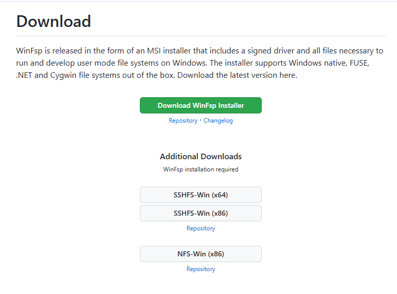
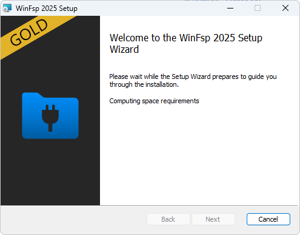
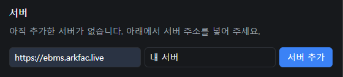
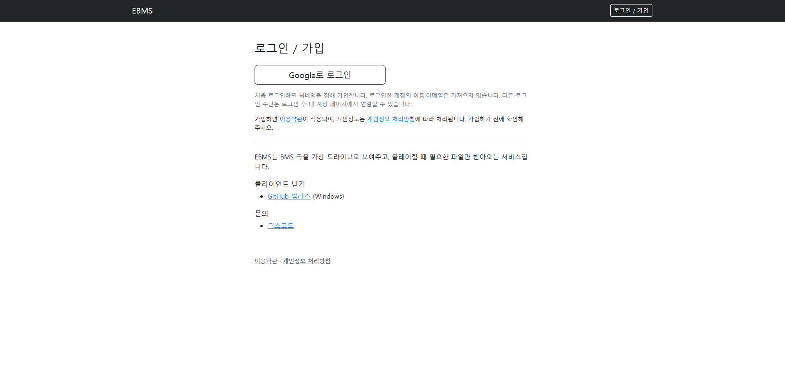
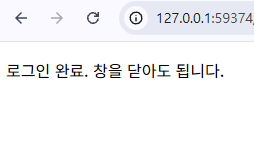
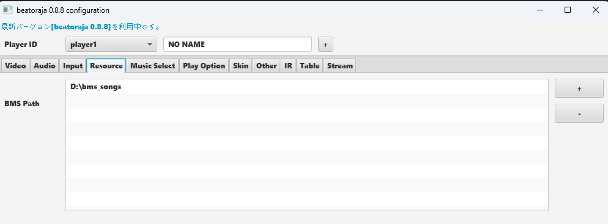

# EBMS 클라이언트 설치 가이드

## 소개

EBMS는 BMS를 시작할 때 걸림돌이던 곡 찾기, 다운로드, 관리, 용량 문제를 줄이려고 만든 프로젝트입니다.
지금까지는 각자 곡 파일을 받아 관리해야 했지만, 이제는 서버에서 필요한 파일을 자동으로 받아 오므로 용량 걱정 없이 플레이할 수 있습니다.

## 동작 방식

- 처음 동기화할 때는 곡 목록을 띄우는 데 필요한 파일(채보, 배너, 미리듣기 등)만 받습니다. 보통 곡 용량의 1/15 정도라, 수십~수백 GB인 통합팩보다 훨씬 가볍습니다.
- 실제 곡(키음·BGA)은 게임에서 곡을 고를 때 자동으로 받습니다. 고른 뒤에 받기 시작하므로 첫 로딩은 짧으면 10초, 길면 30~40초쯤 걸립니다. 서버 상태에 따라 달라질 수 있습니다.
- 곡을 받을 때마다 플레이 티켓을 1개 씁니다. 남은 티켓은 설정 창에서 볼 수 있습니다.

## 지원 구동기

beatoraja, LR2(lr2oraja, LR2body), Qwilight를 기본으로 인식합니다. 충분히 테스트한 구동기는 beatoraja이며, LR2와 Qwilight는 작동에 이상이 있을 수 있습니다. 목록에 없는 구동기는 설정 창의 "구동기 exe 선택"으로 직접 추가할 수 있습니다.

클라이언트는 Windows 전용입니다.

## 설치

### 1. WinFsp 설치

가상 드라이브에 WinFsp가 필요합니다. https://winfsp.dev/rel/ 에서 초록색 **Download WinFsp Installer** 버튼으로 받아 설치한 뒤 재부팅하세요.

### 2. EBMS 받기

[최신 릴리스](https://github.com/alsrjs0725/ebms_client/releases/latest)에서 `ebms-windows-x64.zip`을 받아 원하는 폴더에 압축을 풉니다.

- 받은 파일과 캐시는 **압축을 푼 폴더 안의 `data` 폴더**에 저장됩니다. 여유 공간이 있는 드라이브에 풀어 주세요(사전 다운로드 약 10GB + 캐시 기본 5GB).
- zip에는 `ebms-app.exe`와 라이선스 파일(`LICENSE`, `THIRD_PARTY_LICENSES.html`)만 들어 있습니다.

### 3. 실행

`ebms-app.exe`를 실행하면 설정 창이 뜹니다.

- **설정 창을 닫으면 EBMS가 종료되고 가상 드라이브도 내려갑니다.** 플레이하는 동안에는 창을 켜 두세요(최소화는 괜찮습니다).
- 켤 때 새 버전이 있으면 업데이트할지 묻습니다. "업데이트"를 누르면 알아서 바꾸고 다시 시작하며, `data` 폴더는 그대로 둡니다.
- 서버 공지가 있으면 공지 창이 뜹니다.

## 설정 창

### 서버

곡 파일을 주는 서버입니다. 서버는 하나만 연결합니다.

- 서버 주소: `https://ebms.arkfac.live`

  > **면책 사항**: `ebms.arkfac.live`는 EBMS가 기본으로 제공하는 서버이며, 아직 실험 단계입니다. 사용자 수를 서버가 감당할 수 있는지 시험하고 있어, 정식 출시 전까지는 기술 문제나 서버 불안정으로 서비스를 제공하지 못할 수 있습니다. 그동안 받아 둔 곡은 아직 지우지 마세요.

- 이름(선택): 가상 드라이브의 폴더 이름이 되므로 영어로, 띄어쓰기 없이 적어 주세요.

서버를 추가하면 **로그인** 버튼을 눌러 브라우저에서 로그인합니다. 지금은 Google 로그인으로만 가입할 수 있습니다. 약관에 동의하고 닉네임을 정해 가입하면 "로그인 완료" 창이 뜹니다.

로그인하면 바로 동기화를 시작합니다. 이후에는 EBMS를 켤 때마다 한 번 자동으로 동기화하고, 실행 중에는 **지금 동기화** 버튼으로 받을 수 있습니다.

- 사전 다운로드는 2026년 10월 기준 전곡 약 10GB입니다.
- 서버 카드에 **동기화 중… / 동기화 완료 / 동기화 실패**와 마지막 동기화 시각이 표시됩니다. "동기화 완료"가 뜨면 끝난 것입니다.
- 사전 다운로드에는 월 한도가 있고, 이번 달 사용량이 서버 카드에 보입니다. 동기화도 이 한도에서 빠집니다.
- **사전 다운로드 범위**에서 전곡 대신 고른 난이도표의 곡만 미리 받을 수 있습니다. 고르지 않은 곡도 목록에는 모두 보이며, 다음 동기화에 받을 용량을 미리 보여 줍니다.

### 가상 드라이브

곡이 보일 위치입니다. 기본값은 비어 있는 드라이브 문자 중 가장 뒤의 것이고, **위치 변경**으로 원하는 드라이브 문자나 폴더를 지정할 수 있습니다.

그 안에 서버 이름 폴더가 생기고, 그 아래에 곡 폴더가 보입니다(예: `E:\<서버 이름>\00123 Artist - Title\`). 실제 데이터는 그곳에 저장되지 않으니 자유롭게 정하세요.

구동기가 아닌 프로그램(백업, 검색, 썸네일 등)의 읽기는 거절하므로, 이 폴더는 백업·검색 대상에서 빼 두세요.

### 구동기

목록에 없는 구동기는 **구동기 exe 선택**으로 실행 파일을 직접 고릅니다. 구동기를 다른 폴더로 옮기면 다시 골라 주세요.

### 캐시

한 번 받은 곡은 캐시 용량(기본 5GB)을 넘기 전까지 PC에 보관되어 다시 받지 않습니다. 넘으면 오래 안 쓴 곡부터 지웁니다. 용량은 늘리거나 줄일 수 있습니다.

### 개인 채보

서버에 없는 채보 파일(.bms/.bme/.bml/.pms/.bmson)을 서버의 곡에 연결할 수 있습니다. 연결한 채보는 가상 드라이브의 그 곡 폴더에 보이고 키음·BGA는 그 곡 것을 씁니다. 채보는 서버에 올리지 않고 이 PC에만 복사해 둡니다.

### 로그

오류가 생기면 **로그 폴더 열기**로 로그를 확인할 수 있습니다(최근 7일). 로그에는 폴더 경로 등 PC 정보가 일부 들어 있으니 공유할 때 주의하세요.

## 구동기에 곡 폴더 등록

동기화가 끝나면 쓰던 구동기에 가상 드라이브의 서버 이름 폴더를 곡 폴더로 등록하고 곡 검사를 진행하세요. (아래는 beatoraja 예시)

구동기 자체 설정은 EBMS 범위 밖이라 따로 다루지 않습니다.

## 문의

[디스코드](https://discord.gg/WFckbt4GPt)
